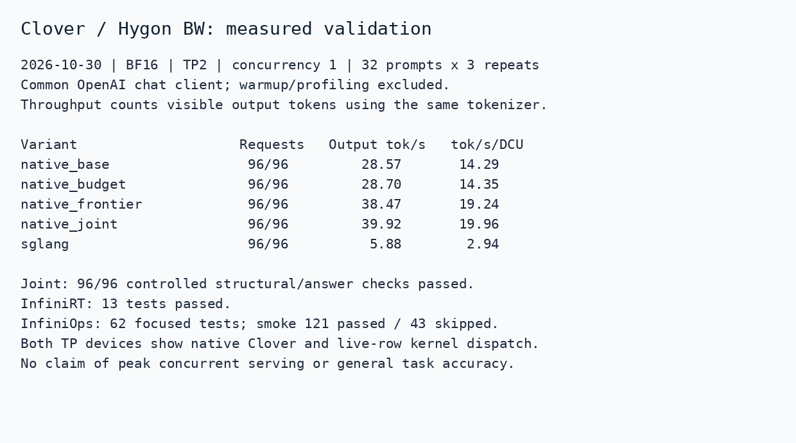

# Clover block diffusion on Hygon

`clover_moe` loads the complete Clover-35B-A3B-Preview checkpoint, including its
right-convolution and bidirectional GDN scalar shards. Model forward runs in
InfiniLM C++; InfiniOps supplies Hygon kernels. Triton compiles kernels on first
use and the native driver launches their binaries thereafter. Torch is used by
the Python decoder for confidence selection, not as a model-forward fallback.

The model currently requires BF16 weights. The validated configuration is TP=2 on two Hygon BW 64GB devices, DTK
26.04, eager execution, static cache, and 32-token diffusion blocks. The chat
endpoint serializes requests and supports greedy, non-streaming text generation.
The measurements below cover concurrency one and short prompts; they are not a
measurement of maximum concurrent-serving capacity or 128K-context performance.

## Build

Build the matching InfiniRT, InfiniOps and InfiniCCL revisions first. The Hygon
InfiniRT driver API and InfiniOps Clover providers are required; the original
InfiniLM dependency pin does not supply them. The dependency PR links are
recorded in this change's PR description.

```sh
export INFINI_ROOT=/path/to/installed-stack
export CUDA_HOME=/opt/dtk/cuda/cuda
export LD_LIBRARY_PATH="$INFINI_ROOT/lib:$CUDA_HOME/lib64:$LD_LIBRARY_PATH"
cmake -S third_party/InfiniCore/submodules/InfiniRT -B build/rt \
  -DCMAKE_INSTALL_PREFIX="$INFINI_ROOT" -DWITH_CPU=ON -DWITH_HYGON=ON
cmake --build build/rt -j 12
cmake --install build/rt
cmake -S third_party/InfiniCore/submodules/InfiniOps -B build/ops \
  -C docs/clover-hygon-ops.cmake -DCMAKE_INSTALL_PREFIX="$INFINI_ROOT" \
  -DINFINI_RT_ROOT="$INFINI_ROOT" -DWITH_CPU=ON -DWITH_HYGON=ON \
  -DWITH_TRITON=ON -DHYGON_ARCH=gfx936 -DGENERATE_PYTHON_BINDINGS=ON \
  -DAUTO_DETECT_DEVICES=OFF -DAUTO_DETECT_BACKENDS=OFF
cmake --build build/ops -j 12
cmake --install build/ops
cmake -S third_party/InfiniCore/submodules/InfiniCCL -B build/ccl \
  -DCMAKE_INSTALL_PREFIX="$INFINI_ROOT" -DWITH_HYGON=ON -DWITH_NCCL=ON \
  -DAUTO_DETECT_DEVICES=OFF -DBUILD_EXAMPLES=OFF
cmake --build build/ccl -j 12
cmake --install build/ccl
export INFINILM_CXX11_ABI=1
xmake f -y -m release --cxx11-abi=1
pip install -e '.[clover]' --no-build-isolation
```

Match the C++ ABI to the installed DTK Torch build. `gfx936` is the tested
architecture, not a default for all Hygon products. Install the InfiniOps Python
package as `infini` as well: its JIT compiler and kernel sources must remain
importable. A direct CMake install puts that package at the install prefix;
placing a link named `infini` to this prefix in a Python search directory is
sufficient for a development build. A wheel installs this namespace normally.

The declaration preset lets the complete InfiniLM source compile when other
model families reference operators without Hygon providers. Such operators
remain unsupported; generating their APIs does not install substitute kernels.

## Generate and serve

```python
from infinilm.diffusion.clover import CloverGenerator

generator = CloverGenerator('/path/to/Clover-35B-A3B-Preview', tp=2, max_context=2048)
result = generator.generate('What is the capital of France?', max_new_tokens=64)
print(result.text)
```

```sh
HIP_VISIBLE_DEVICES=0,1 python -m infinilm.server.clover_server \
  --model /path/to/Clover-35B-A3B-Preview --tp 2 --max-context 2048 \
  --policy frontier --expert-budget --frontier-floor 0.7 --port 8000
```

Send ordinary `/v1/chat/completions` requests with `temperature: 0` and
`stream: false`. Optional request fields are `diffusion_policy` (`baseline` or
`frontier`), `expert_budget`, and `frontier_confidence_floor`. Neutral repetition,
presence and frequency penalties and thinking disabled define the tested lane.
Nonzero penalties, stochastic sampling and streaming receive explicit errors.

## Methods and state contract

Preview reads the committed convolution/GDN state. Full attention can read the
causal prefix and all positions within the current block. Preview KV writes are
confined to the uncommitted suffix. Every block is fully resolved before causal
replay updates persistent state. Mask tokens are never emitted or committed.

`baseline` uses the checkpoint's 0.95 low-confidence rule with top-one progress
when no masked position clears the threshold. `frontier` adapts the target
stride from Ringssss/dLLM-serve V3. It retains all positions above 0.95, adds
safe positions toward the stride, and guarantees progress. Its confidence
floor is explicit because lowering it changes decoding and can harm output.

`expert_budget` adapts the supplied dllm-h100 study's top-4 expert budget and
TV6 decoded-row reuse with refresh interval five. Clover's own block coreset
continues to define the allowed experts. A token is eligible for reuse only
when it was unmasked in both consecutive previews. Inactive routes are omitted
from expert alignment/GEMMs and their previously combined outputs are restored.
Shared experts and causal replay still compute normally. State is reset at each
new block/request. These are optional approximate preview optimizations.

This port does not implement the H100 code's DP/EP sequence-parallel communication
pipeline, or dLLM-serve's complete admission/compaction scheduler. The serial
endpoint exposes the mechanisms validated here. It also does not implement
Clover's separate self-speculative AR-verification serving mode.

Source provenance:

- dLLM-serve: `1da50a96c9ce6b888d245d378f2bac0425feba8c`,
  `cwsrpt_v2/algorithm/cw_srpt_v3.py`, Apache-2.0; retained license/notice under
  `python/infinilm/licenses/dLLM-serve`.
- Supplied dllm-h100 archive: top-4 routing and refresh/live-row logic in
  `codex_coding/src/{test_m_skip_sweep.py,tv6_patch.py}`; reimplemented for the
  Clover softmax router and InfiniLM state ownership.
- Preview kernels are provided and attributed by the companion InfiniOps PR.

## Validation and measurement

The native baseline matched the local SGLang Clover port's output tokens on
four initial prompts. Operator comparisons cover preview convolution/GDN,
clean-state immutability, packed recurrent commits, expert selection, fused
MoE, liveness and cached-row merging. Broader generative outputs can differ
across kernel implementations even with identical sampling settings.

The recorded HTTP campaign uses the same model, tokenizer, BF16 precision,
TP2 budget, prompts, per-request output caps and sampling controls. Each of five
lanes ran 32 prompts three times after a separate warmup, alternating lane
order. Throughput is visible completion tokens, retokenized identically, divided
by summed client request time. SGLang's diffusion usage counters can include
block padding, so they are not used as the numerator. Results and the exact
workload are recorded in the PR evidence; no profiling run contributes to timing.

A portable client and the controlled 32-prompt workload are included:

```sh
python examples/bench_clover.py --url http://127.0.0.1:8000 --model clover \
  --tokenizer /path/to/Clover-35B-A3B-Preview --output native.jsonl
python examples/bench_clover.py --url http://127.0.0.1:8001 --model /served/model/name \
  --tokenizer /path/to/Clover-35B-A3B-Preview --backend sglang --variants baseline --output sglang.jsonl
```

Repeat `-1` is warmup and must be excluded. Sum `visible_tokens` over successful
requests and divide by summed `elapsed_s` over all measured requests, retaining
failures. Keep model weights, TP, sampling, output caps and context capacity fixed.

### Recorded short-prompt campaign

| Variant | Visible output tok/s | Per DCU tok/s |
| --- | ---: | ---: |
| InfiniLM baseline | 28.57 | 14.29 |
| Frontier stride | 38.47 | 19.24 |
| Expert budget and live-row reuse | 28.70 | 14.35 |
| Joint, confidence floor 0.7 | 39.92 | 19.96 |
| Local SGLang Clover iterative port | 5.88 | 2.94 |

The joint path is 1.397x the native baseline and 6.791x this local SGLang port.
Three joint repetitions measured 39.85–40.02 visible tok/s. The SGLang reference
is the local DTK 0.5.12 port of iterative Clover, with eager Triton attention/MoE;
it is not the official self-speculative implementation. The two lanes use
separate pairs of identical BW devices on the same host. Context capacity is
2048 for both. These numbers include HTTP/request latency and real EOS behavior.

All requests completed. The controlled structural/answer checks passed 96/96
for joint, 93/96 for expert-only and 90/96 for baseline/frontier/SGLang. This
checks the included fixture, not general quality equivalence. Generated text
can still contain imperfect wording. A lower floor of 0.5 produced invalid
Python and repetitions and was rejected. Keep outputs and failed candidates in
any further evaluation.


