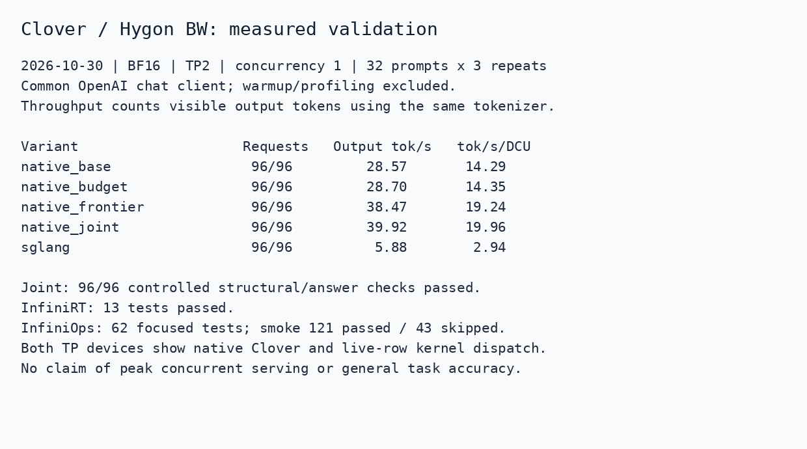

# Clover block diffusion

`clover_moe` loads the complete Clover-35B-A3B-Preview checkpoint, including its
right-convolution and bidirectional GDN scalar shards. Model forward runs in
InfiniLM C++; InfiniOps supplies the device kernels, on NVIDIA and on Hygon.
Both platforms run Triton kernels that are compiled on first use and launched
by the native driver thereafter; differences between the two are noted where
they apply. Torch is used by the Python decoder for confidence selection, not
as a model-forward fallback.

The model currently requires BF16 weights. Validated configurations: TP=2 on
two NVIDIA A100 80GB (CUDA 13.1) and TP=2 on two Hygon BW 64GB devices (DTK
26.04), both eager execution, static cache, and 32-token diffusion blocks. The
chat endpoint serializes requests and supports greedy, non-streaming text
generation. The measurements below cover concurrency one and short prompts;
they are not a measurement of maximum concurrent-serving capacity or
128K-context performance.

## Build

Build the matching InfiniRT, InfiniOps and InfiniCCL revisions first. The
InfiniRT driver API and InfiniOps Clover providers for your device are
required; the original InfiniLM dependency pin does not supply them. The
dependency PR links are recorded in this change's PR description. Pick the
block matching your platform below (same `INFINI_ROOT` and final `pip install`
step for both).

### NVIDIA

```sh
export INFINI_ROOT=/path/to/installed-stack
export CUDA_HOME=/usr/local/cuda
export LD_LIBRARY_PATH="$INFINI_ROOT/lib:$CUDA_HOME/lib64:$LD_LIBRARY_PATH"
cmake -S third_party/InfiniCore/submodules/InfiniRT -B build/rt \
  -DCMAKE_INSTALL_PREFIX="$INFINI_ROOT" -DWITH_CPU=ON -DWITH_NVIDIA=ON
cmake --build build/rt -j 12
cmake --install build/rt
cmake -S third_party/InfiniCore/submodules/InfiniOps -B build/ops \
  -C docs/clover-ops.cmake -DCMAKE_INSTALL_PREFIX="$INFINI_ROOT" \
  -DINFINI_RT_ROOT="$INFINI_ROOT" -DWITH_CPU=ON -DWITH_NVIDIA=ON \
  -DWITH_TRITON=ON -DCMAKE_CUDA_ARCHITECTURES=80 \
  -DGENERATE_PYTHON_BINDINGS=ON \
  -DAUTO_DETECT_DEVICES=OFF -DAUTO_DETECT_BACKENDS=OFF
cmake --build build/ops -j 12
cmake --install build/ops
cmake -S third_party/InfiniCore/submodules/InfiniCCL -B build/ccl \
  -DCMAKE_INSTALL_PREFIX="$INFINI_ROOT" -DWITH_NVIDIA=ON -DWITH_NCCL=ON \
  -DAUTO_DETECT_DEVICES=OFF -DBUILD_EXAMPLES=OFF
cmake --build build/ccl -j 12
cmake --install build/ccl
```

Set `CMAKE_CUDA_ARCHITECTURES` to the real target arch (e.g. `80` for A100);
the default `75` compiles but CUTLASS bf16 MMA paths fail at runtime. The
InfiniOps build needs the multi-device Clover operators (see the companion
InfiniOps PR referenced above); the operators in the pinned revision are
Hygon-only.

### Hygon

```sh
export INFINI_ROOT=/path/to/installed-stack
export CUDA_HOME=/opt/dtk/cuda/cuda
export LD_LIBRARY_PATH="$INFINI_ROOT/lib:$CUDA_HOME/lib64:$LD_LIBRARY_PATH"
cmake -S third_party/InfiniCore/submodules/InfiniRT -B build/rt \
  -DCMAKE_INSTALL_PREFIX="$INFINI_ROOT" -DWITH_CPU=ON -DWITH_HYGON=ON
cmake --build build/rt -j 12
cmake --install build/rt
cmake -S third_party/InfiniCore/submodules/InfiniOps -B build/ops \
  -DCMAKE_BUILD_TYPE=Release \
  -C docs/clover-ops.cmake -DCMAKE_INSTALL_PREFIX="$INFINI_ROOT" \
  -DINFINI_RT_ROOT="$INFINI_ROOT" -DWITH_CPU=ON -DWITH_HYGON=ON \
  -DWITH_TRITON=ON -DHYGON_ARCH=gfx936 -DGENERATE_PYTHON_BINDINGS=ON \
  -DAUTO_DETECT_DEVICES=OFF -DAUTO_DETECT_BACKENDS=OFF
cmake --build build/ops -j 12
cmake --install build/ops
cmake -S third_party/InfiniCore/submodules/InfiniCCL -B build/ccl \
  -DCMAKE_BUILD_TYPE=Release \
  -DCMAKE_INSTALL_PREFIX="$INFINI_ROOT" -DWITH_HYGON=ON -DWITH_NCCL=ON \
  -DAUTO_DETECT_DEVICES=OFF -DBUILD_EXAMPLES=OFF
cmake --build build/ccl -j 12
cmake --install build/ccl
```

Match the C++ ABI to the installed DTK Torch build. `gfx936` is the tested
architecture, not a default for all Hygon products.

With InfiniOps at `1d44dcaa` or later the fused MoE runs native `gfx936`
kernels instead of Triton; `INFINI_OPS_HYGON_MOE_TRITON=1` selects the Triton
kernels (see "Native fused MoE on gfx936" in the InfiniOps
`docs/clover-hygon.md`).

### Common

```sh
export INFINILM_CXX11_ABI=1
xmake f -y -m release --cxx11-abi=1
pip install -e '.[clover]' --no-build-isolation
```

Install the InfiniOps Python
package as `infini` as well: its JIT compiler and kernel sources must remain
importable. A direct CMake install puts that package at the install prefix;
placing a link named `infini` to this prefix in a Python search directory is
sufficient for a development build. A wheel installs this namespace normally.

The declaration preset lets the complete InfiniLM source compile when other
model families reference operators without providers for the selected
platform. Such operators remain unsupported; generating their APIs does not
install substitute kernels.

The `pip install -e` step copies the Infini libraries from `$INFINI_ROOT/lib`
into `python/infinilm/_lib`, and the package loads those copies. Repeat it
after rebuilding an Infini library; otherwise the model keeps running the
previous build.

The build types match the entries the top-level README uses: `pip install`
builds InfiniOps as Release (the scikit-build-core default) and
`scripts/build.sh` builds InfiniCCL as Release, while the InfiniRT command
sets none. Without a build type CMake adds no optimization flags. Release also
defines `NDEBUG`, which compiles out InfiniOps' operator-contract `assert`s;
drop it from the InfiniOps command when diagnosing rejected operator
arguments.

## Generate and serve

`device` accepts the framework's device names and aliases (`cuda`/`nvidia`,
`hygon`, …); `tp` defaults to 1, and the server's `--device` defaults to
`auto` (auto-detects the local platform like the main inference server). The
examples below use NVIDIA names; on Hygon pass `hygon` and select the devices
with `HIP_VISIBLE_DEVICES`.

```python
from infinilm.diffusion.clover import CloverGenerator

generator = CloverGenerator('/path/to/Clover-35B-A3B-Preview', tp=2, max_context=2048, device='nvidia')
result = generator.generate('What is the capital of France?', max_new_tokens=64)
print(result.text)
```

A single-process smoke test with three prompts:

```sh
python examples/test_clover.py --device nvidia --model /path/to/Clover-35B-A3B-Preview
```

```sh
CUDA_VISIBLE_DEVICES=0,1 python -m infinilm.server.clover_server \
  --model /path/to/Clover-35B-A3B-Preview --tp 2 --max-context 2048 \
  --policy frontier --expert-budget --frontier-floor 0.7 --port 8000
```

Send ordinary `/v1/chat/completions` requests with `temperature: 0` and
`stream: false`. Optional request fields are `diffusion_policy` (`baseline` or
`frontier`), `expert_budget`, and `frontier_confidence_floor`. Neutral repetition,
presence and frequency penalties and thinking disabled define the tested lane.
Nonzero penalties, stochastic sampling and streaming receive explicit errors.

## Methods and state contract

Preview reads the committed convolution/GDN state. Full attention can read the
causal prefix and all positions within the current block. Preview KV writes are
confined to the uncommitted suffix. Every block is fully resolved before causal
replay updates persistent state. Mask tokens are never emitted or committed.

`baseline` uses the checkpoint's 0.95 low-confidence rule with top-one progress
when no masked position clears the threshold. `frontier` adapts the target
stride from Ringssss/dLLM-serve V3. It retains all positions above 0.95, adds
safe positions toward the stride, and guarantees progress. Its confidence
floor is explicit because lowering it changes decoding and can harm output.

`expert_budget` adapts the supplied dllm-h100 study's top-4 expert budget and
TV6 decoded-row reuse with refresh interval five. Clover's own block coreset
continues to define the allowed experts. A token is eligible for reuse only
when it was unmasked in both consecutive previews. Inactive routes are omitted
from expert alignment/GEMMs and their previously combined outputs are restored.
Shared experts and causal replay still compute normally. State is reset at each
new block/request. These are optional approximate preview optimizations.

This port does not implement the H100 code's DP/EP sequence-parallel communication
pipeline, or dLLM-serve's complete admission/compaction scheduler. The serial
endpoint exposes the mechanisms validated here. It also does not implement
Clover's separate self-speculative AR-verification serving mode.

Source provenance:

- dLLM-serve: `1da50a96c9ce6b888d245d378f2bac0425feba8c`,
  `cwsrpt_v2/algorithm/cw_srpt_v3.py`, Apache-2.0; retained license/notice under
  `python/infinilm/licenses/dLLM-serve`.
- Supplied dllm-h100 archive: top-4 routing and refresh/live-row logic in
  `codex_coding/src/{test_m_skip_sweep.py,tv6_patch.py}`; reimplemented for the
  Clover softmax router and InfiniLM state ownership.
- Preview kernels are provided and attributed by the companion InfiniOps PR.

## Validation and measurement

The native baseline matched the local SGLang Clover port's output tokens on
four initial prompts. Operator comparisons cover preview convolution/GDN,
clean-state immutability, packed recurrent commits, expert selection, fused
MoE, liveness and cached-row merging. Broader generative outputs can differ
across kernel implementations even with identical sampling settings.

All throughput numbers below were recorded on Hygon, on two BW 64GB devices
with TP=2.

The recorded HTTP campaign uses the same model, tokenizer, BF16 precision,
TP2 budget, prompts, per-request output caps and sampling controls. Each of five
lanes ran 32 prompts three times after a separate warmup, alternating lane
order. Throughput is visible completion tokens, retokenized identically, divided
by summed client request time. SGLang's diffusion usage counters can include
block padding, so they are not used as the numerator. Results and the exact
workload are recorded in the PR evidence; no profiling run contributes to timing.

A portable client and the controlled 32-prompt workload are included:

```sh
python examples/bench_clover.py --url http://127.0.0.1:8000 --model clover \
  --tokenizer /path/to/Clover-35B-A3B-Preview --output native.jsonl
python examples/bench_clover.py --url http://127.0.0.1:8001 --model /served/model/name \
  --tokenizer /path/to/Clover-35B-A3B-Preview --backend sglang --variants baseline --output sglang.jsonl
```

Repeat `-1` is warmup and must be excluded. Sum `visible_tokens` over successful
requests and divide by summed `elapsed_s` over all measured requests, retaining
failures. Keep model weights, TP, sampling, output caps and context capacity fixed.

### Logit comparison with the reference implementation

`test/diffusion` compares engine logits with the checkpoint's reference
implementation on the same inputs and decoding trajectory. Record the
reference in BF16, repeat it in FP32 as the truth, replay it with the engine
and compare:

```sh
python test/diffusion/reference_logits.py --model /path/to/Clover-35B-A3B-Preview --out ref_bf16
python test/diffusion/reference_logits.py --model /path/to/Clover-35B-A3B-Preview --out ref_fp32 --dtype float32 --trajectory ref_bf16
python test/diffusion/engine_logits.py --model /path/to/Clover-35B-A3B-Preview --reference ref_bf16 --out engine --device nvidia
python test/diffusion/compare_logits.py --truth ref_fp32 bf16_reference=ref_bf16 engine=engine
```

Each command handles cases `0,1,2,3` of the workload; `--cases` selects
others. The FP32 run needs devices that hold about 139 GB of weights.

### Recorded short-prompt campaign on Hygon

| Variant | Visible output tok/s | Per device tok/s |
| --- | ---: | ---: |
| InfiniLM baseline | 28.57 | 14.29 |
| Frontier stride | 38.47 | 19.24 |
| Expert budget and live-row reuse | 28.70 | 14.35 |
| Joint, confidence floor 0.7 | 39.92 | 19.96 |
| Local SGLang Clover iterative port | 5.88 | 2.94 |

The joint path is 1.397x the native baseline and 6.791x this local SGLang port.
Three joint repetitions measured 39.85–40.02 visible tok/s. The SGLang reference
is the local DTK 0.5.12 port of iterative Clover, with eager Triton attention/MoE;
it is not the official self-speculative implementation. The two lanes use
separate pairs of identical BW devices on the same host. Context capacity is
2048 for both. These numbers include HTTP/request latency and real EOS behavior.

All requests completed. The controlled structural/answer checks passed 96/96
for joint, 93/96 for expert-only and 90/96 for baseline/frontier/SGLang. This
checks the included fixture, not general quality equivalence. Generated text
can still contain imperfect wording. A lower floor of 0.5 produced invalid
Python and repetitions and was rejected. Keep outputs and failed candidates in
any further evaluation.


